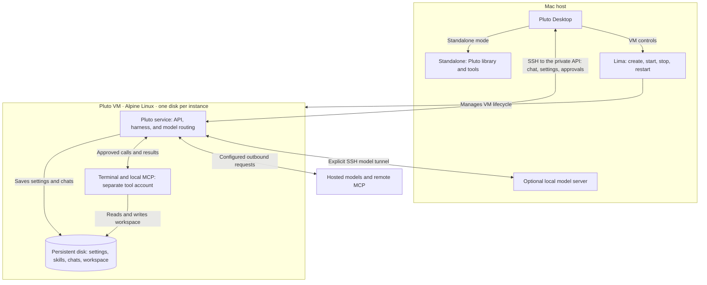
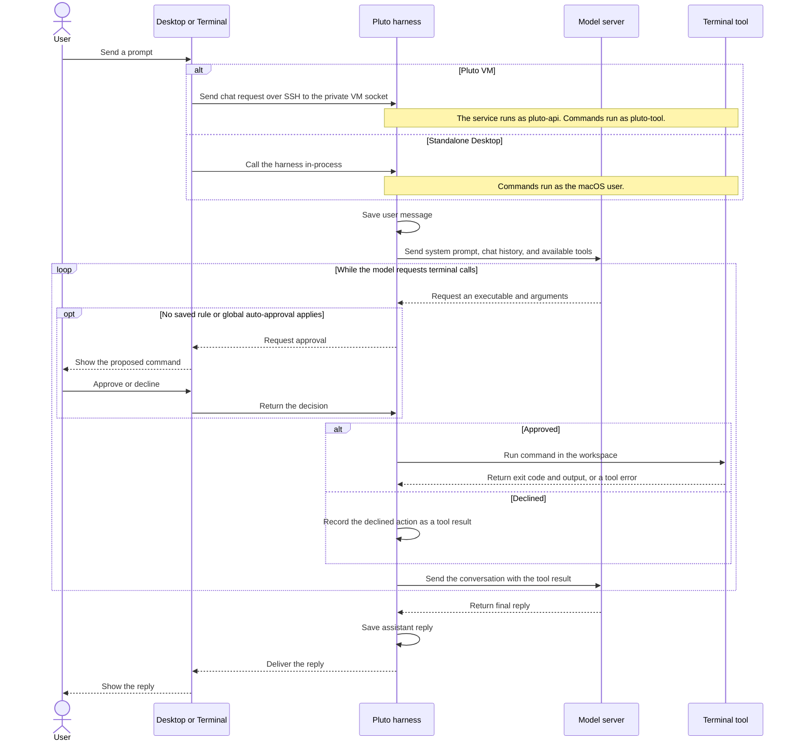
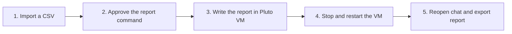

# Pluto sandbox design and research

[Home](../README.md) · [Development guide](../DEVELOPMENT.md) · [VM setup](../pluto/vm/README.md)

Pluto VM runs the harness and tools inside a persistent Lima guest. Pluto Desktop connects over SSH to the service’s private Unix socket. Standalone mode runs the same harness on the host.

| Topic | Where to read |
| --- | --- |
| Process and chat flow | [Chosen sandbox design](#chosen-sandbox-design) |
| Design decisions and tradeoffs | [Harness placement](#1-why-the-harness-and-tools-run-together) · [Lima launcher](#3-why-lima-runs-the-build-and-runtime-vms) |
| Files, credentials, approvals, and network | [VM boundary](#2-what-crosses-the-vm-boundary) |
| Verified behavior and historical benchmarks | [Smoke test](#4-what-the-csv-smoke-test-verified) · [Measurement data (CSV)](sandbox-measurements.csv) |
| Unimplemented designs | [Host integration proposals](#5-proposed-host-integrations) |

## Chosen sandbox design

| Mode | Where Pluto runs | Where terminal commands and local MCP servers run |
| --- | --- | --- |
| Standalone | In the Pluto Desktop process on your Mac | On the Mac with your account’s permissions |
| Pluto VM | In the Pluto service inside a Linux VM | Inside the VM under a separate tool account |

### How a chat turn runs

In Pluto VM, the workspace is `/var/lib/pluto-workspace`. The VM owner installs system packages such as Python through Lima. Pluto can then use those executables through the terminal tool. The tool accepts the executable and its arguments as separate fields. For example, `{"command":"python3","args":["--version"]}`. [VM transport and persistence](../pluto/src/vm.rs) · [Tool loop](../pluto/src/agent.rs) · [Terminal tool](../pluto/src/tools.rs) · [Use Pluto from Terminal](../pluto/vm/README.md#use-pluto-without-desktop)

## 1. Why the harness and tools run together

The first design proposed a small, disposable VM for each command. Pluto could import a CSV, run Python with networking off, and return a report. This would isolate the command while leaving chat, tool orchestration, and conversation history on the Mac.

The **harness** routes model requests, presents tool calls for approval, and feeds results back into the conversation. Moving it into the VM gives Desktop and future clients one place to send prompts and approvals. It also lets Pluto reopen a conversation together with the files its tools created.

| Design option | Benefit | Cost |
| --- | --- | --- |
| Keep the harness on the Mac and isolate commands in a VM | Smaller change to Desktop. Chat can start before the VM boots. | The harness and chat history stay on the Mac. Files and tool results must cross the boundary as needed. |
| **Run the harness and tools in Pluto VM** | Workspace and conversation survive together. A client can connect over the API. | VM mode waits for the VM to boot. Prompts, progress, and approvals need a service API. |

Standalone mode preserves the existing Mac workflow. The repository has two Rust projects with separate lockfiles. `pluto` owns the harness, tools, model routing, and headless service. `pluto-desktop` owns the Mac interface and uses the Pluto library directly in standalone mode. Both modes run the same harness code and keep separate local state. [Package boundaries](../DEVELOPMENT.md#package-boundaries)

## 2. What crosses the VM boundary

- **Approvals** control whether a tool call runs. Terminal commands and local MCP servers run under a separate Linux account with a clean environment. That account can write to the workspace and has restricted access to the service’s settings and state. [Account and launcher setup](../pluto/vm/setup-vm.sh)
- **Files and network.** Lima plain mode disables shared host mounts and automatic port forwarding. The VM can make outbound requests and reach a model port you explicitly forward. [VM defaults](../pluto/vm/lima.yaml)
- **Inference.** A local model server can use the Mac’s GPU through the forwarded port. Pluto can also use a configured hosted provider. Model discovery and fallback checks originate inside the VM and use its credentials. The VM ships without model weights. [Model setup](../pluto/vm/README.md#2-connect-a-model)
- **Settings.** Desktop uses the same settings tabs in both modes. The VM writes its own settings to its disk and reads them for each new turn. Desktop separately uses Lima for lifecycle controls and reads live guest CPU and RAM over SSH. [VM settings and runtime](../pluto/vm/README.md#configure-a-vm-in-desktop)

## 3. Why Lima runs the build and runtime VMs

The prototype uses **Lima with Apple Virtualization and Alpine ARM64** to test the service, approvals, and persistence on Apple Silicon. Lima handles image provisioning, startup, the virtual disk, and SSH access, so the assistant could be tested before investing in a dedicated Mac launcher.

| Option | Rationale |
| --- | --- |
| **Lima with Apple Virtualization** | It gave the prototype a ready-to-use VM lifecycle and SSH connection. Users need a separate Lima installation. |
| Direct Apple Virtualization launcher | Would give Desktop control over setup, startup, and recovery. It would also require image management, networking, a control channel, and signing. Any startup improvement needs measurement. |
| QEMU or a KVM-based launcher | Candidates for Linux or broader host support. Each would need its own provisioning and verification. |

The early Docker build was replaced with a separate **Lima builder VM**. It compiles Pluto natively on Alpine ARM64 with **3 GiB RAM** and an **8 GiB disk**. Each **runtime VM** gets its own disk. The installer replaces Pluto’s executable in place, so upgrades keep that disk. Desktop’s **New VM** uses the same builder and provisioning steps. [Install Pluto VM](../pluto/vm/README.md#1-install-pluto-vm)

Two ideas from Abhishek Bhardwaj’s *From Fork to Fleet* informed the prototype. A VM provides a separate kernel, and a durable disk keeps work after shutdown. One local VM was enough to test both. Checkpointing and fleet scheduling solve different problems and stayed outside the prototype. [VM isolation](https://www.youtube.com/watch?v=OqM67QG_Ikk&t=1109s) · [Durable disks](https://www.youtube.com/watch?v=OqM67QG_Ikk&t=1804s)

## 4. What the CSV smoke test verified

An OpenAI-compatible fixture drove terminal and local MCP calls. An approved command turned an imported CSV into a report. A declined command left no file. After a cold restart, the test reopened the chat, exported the report, and checked that the next model request included the saved conversation. The follow-up test also checked that model settings survived restart and update. [VM smoke test](../pluto/tests/vm_smoke.py)

### Historical measurements

The [measurement CSV](sandbox-measurements.csv) records one observation per row. Each row supplies a numeric value, unit, precision, and the conditions for that observation. The runs used Apple Silicon. VM timings measured the time to the first API response before model inference. The original Desktop baseline used a Rust 1.100.0 release build on macOS 26.7.3 before the package split.

The runtime defaults are **2 vCPUs, 512 MiB RAM, and a 4 GiB sparse disk**. Total host memory, disk growth over time, and time to the first reply with a live model remain open measurements. [Runtime defaults](../pluto/vm/lima.yaml)

## 5. Proposed host integrations

Two ideas from the research remain proposals:

1. **Mac-only tools.** A Mac-side MCP service could expose one operation such as “summarize up to 10 unread emails from today.” The Mac would keep the existing login and validate the request. Pluto would ask for approval before calling the tool. The returned content would enter the selected model’s context, including when that model is hosted.
2. **Memory indexing.** The proposed design keeps the index and small jobs inside Pluto VM. If profiling shows embedding batches need acceleration, Pluto could send selected text to a local Mac service and store the returned vectors on the VM’s disk. This would allow testing Mac GPU acceleration without changing the VM launcher.

End-to-end response time with a live model, total host memory during a tool-heavy turn, and disk growth after repeated work can inform whether to keep Lima as the user-facing launcher and how much work to move to the host.
